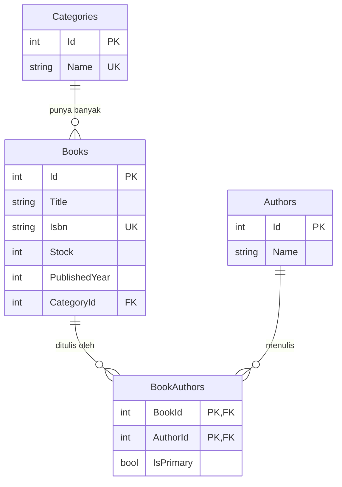

# LibraryApp

LibraryApp adalah aplikasi console untuk mengelola data buku perpustakaan, dibuat dengan C# (.NET 8) dan EF Core (SQLite) sebagai tugas "Create CRUD Using EF Core". Aplikasi ini mendemonstrasikan operasi CRUD untuk Category, Author, dan Book, relasi one-to-many (Category–Book), relasi many-to-many dengan pivot eksplisit (Book–Author), serta migration.

## Teknologi

- .NET 8 (C#, nullable reference types aktif)
- EF Core 8 dengan provider SQLite
- `Microsoft.Extensions.DependencyInjection` untuk dependency injection

## Prasyarat

- [.NET SDK 8](https://dotnet.microsoft.com/download/dotnet/8.0) (versi dikunci lewat `global.json`)
- (Opsional, hanya untuk membuat migration baru) tool EF:
  ```bash
  dotnet tool install --global dotnet-ef --version 8.*
  ```

## Cara menjalankan

Jalankan dari folder root proyek (yang berisi `LibraryApp.csproj`):

```bash
dotnet build
dotnet run
```

Saat pertama kali dijalankan, aplikasi otomatis:

1. membuat database `library.db` di folder kerja,
2. menerapkan semua migration (membuat tabel),
3. mengisi data contoh bila database masih kosong (2 kategori, 3 penulis, 2 buku),
4. menampilkan menu utama.

Tidak ada login. Semua fitur langsung tersedia.

Untuk mengulang dari awal, hapus `library.db` (beserta `library.db-shm` dan `library.db-wal` bila ada), lalu jalankan `dotnet run` lagi.

## Fitur

| Menu | Fitur |
| ---- | ----- |
| Kategori | Daftar, tambah, ubah, hapus |
| Penulis | Daftar, tambah, ubah, hapus |
| Buku | Daftar (tabel dengan kategori dan penulis), cari berdasarkan judul, detail, tambah, ubah, hapus |

Aturan yang diterapkan:

- Nama kategori unik (tanpa membedakan huruf besar/kecil); kategori yang masih punya buku tidak bisa dihapus.
- Penulis yang masih dipakai buku tidak bisa dihapus.
- ISBN unik; `Stock >= 0`; tahun terbit antara 1000 dan tahun sekarang.
- Setiap buku punya satu kategori dan minimal satu penulis, dengan tepat satu penulis utama.
- Mengubah buku dapat mengganti kategori dan penulisnya; menghapus buku ikut menghapus relasi penulisnya.
- Input tidak valid (teks di kolom angka, kosong, di luar rentang) ditolak dengan pesan dan diminta ulang, tanpa membuat aplikasi berhenti.

## Relasi data



- **Category – Book (1:N):** `OnDelete(Restrict)`, kategori tidak bisa dihapus selama masih punya buku.
- **Book – Author (N:M):** lewat pivot eksplisit `BookAuthors` dengan composite key `(BookId, AuthorId)` dan kolom tambahan `IsPrimary`. Relasi pivot memakai `Cascade`.

## Struktur proyek

```
LibraryApp/
├─ Program.cs               Composition root: DI, migrate, seed, jalankan menu
├─ Common/Result.cs         Hasil operasi (sukses/gagal + pesan)
├─ Domain/Entities/         Category, Author, Book, BookAuthor
├─ Data/
│  ├─ AppDbContext.cs
│  ├─ DesignTimeDbContextFactory.cs
│  ├─ Configurations/       Konfigurasi Fluent API per entity
│  ├─ Migrations/
│  └─ DbSeeder.cs           Data contoh (idempotent)
├─ Services/                Logika bisnis dan validasi
└─ UI/                      Semua Console.WriteLine/ReadLine hanya di sini
```

Aturan layering: `UI` hanya memanggil `Services`; `Services` tidak memanggil `Console`; `Domain` tidak bergantung pada EF Core.

## Migration

```bash
dotnet ef migrations add <Nama> --output-dir Data/Migrations
dotnet ef database update
```

Aplikasi juga menerapkan migration otomatis saat startup, jadi `dotnet ef database update` tidak wajib dijalankan sebelum `dotnet run`.
